# BOY series 2.0 (KICKBOY / BASSBOY / TUNEBOY) by sonicsystems

## Download (Windows VST3)

Skompilowane pluginy (te same, które są obecnie w FL Studio): [release v2026-10-21](https://github.com/ssonicsystemss/KICKBOY-BASSBOY-TUNEBOY/releases/tag/v2026-10-21)

- [KICKBOY-win64-vst3.zip](https://github.com/ssonicsystemss/KICKBOY-BASSBOY-TUNEBOY/releases/download/v2026-10-21/KICKBOY-win64-vst3.zip)
- [BASSBOY-win64-vst3.zip](https://github.com/ssonicsystemss/KICKBOY-BASSBOY-TUNEBOY/releases/download/v2026-10-21/BASSBOY-win64-vst3.zip)
- [TUNEBOY-win64-vst3.zip](https://github.com/ssonicsystemss/KICKBOY-BASSBOY-TUNEBOY/releases/download/v2026-10-21/TUNEBOY-win64-vst3.zip)

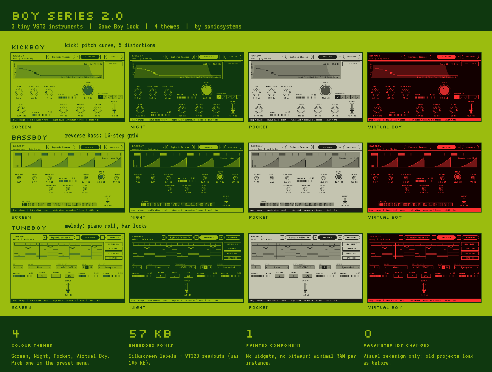

| Plugin | What it does | Hero control |
|---|---|---|
| KICKBOY | hardstyle kick | stepped pitch curve (drag = Pitch Start / Decay) |
| BASSBOY | tempo-synced reverse bass | 16-step grid with playhead |
| TUNEBOY | melody + chords generator | piano roll, bar locks |

## Themes
Screen (default), Night, Pocket, Virtual Boy. Pick one in the preset menu (SELECT button). The theme is stored in the
plugin state, not as a parameter, so no parameter IDs changed.

| | Screen | Night | Pocket | Virtual Boy |
|---|---|---|---|---|
| KICKBOY | 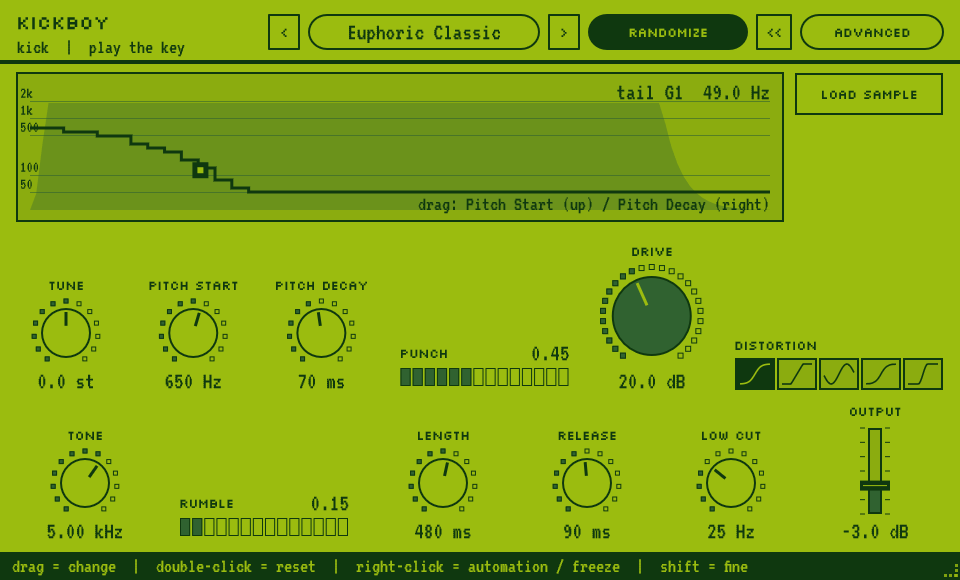 | 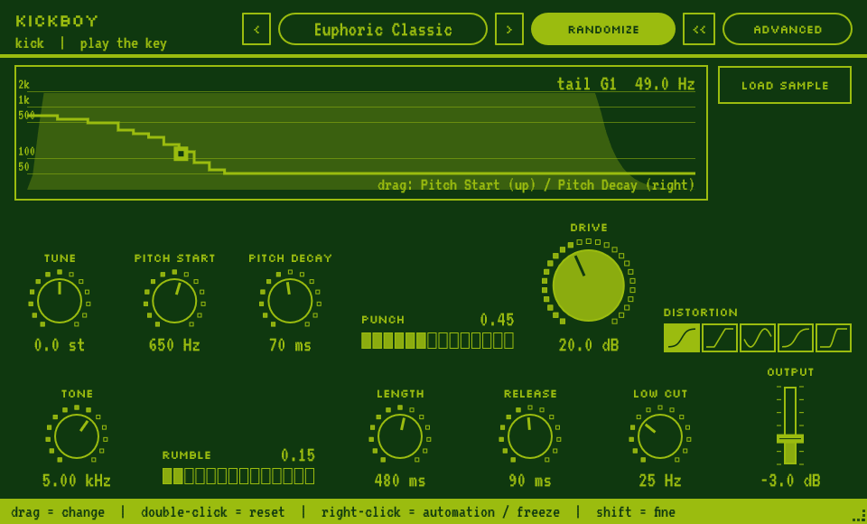 | 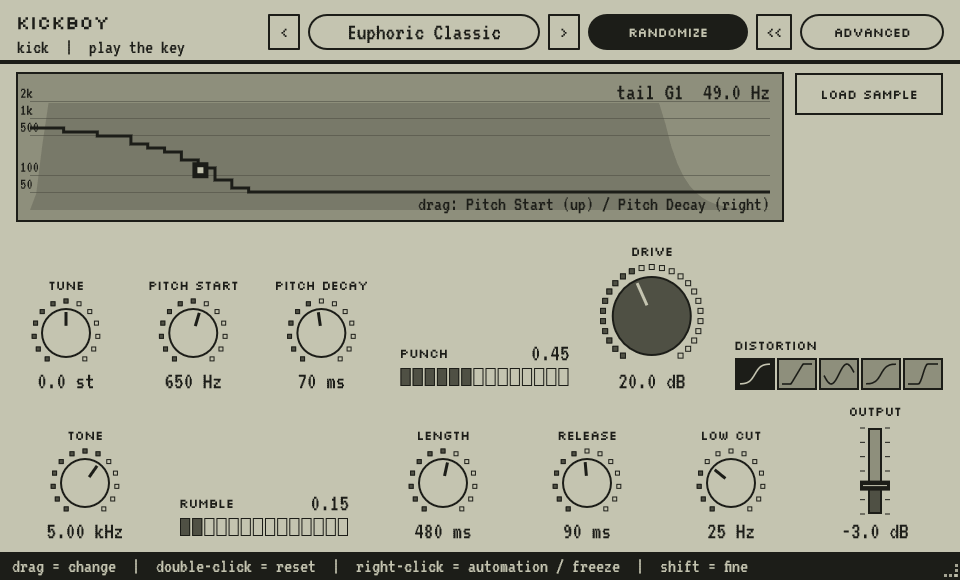 | 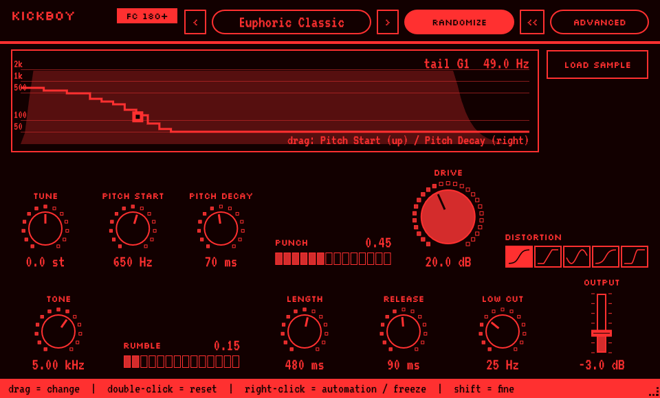 |
| BASSBOY | 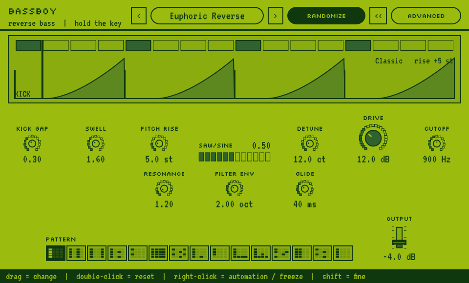 | 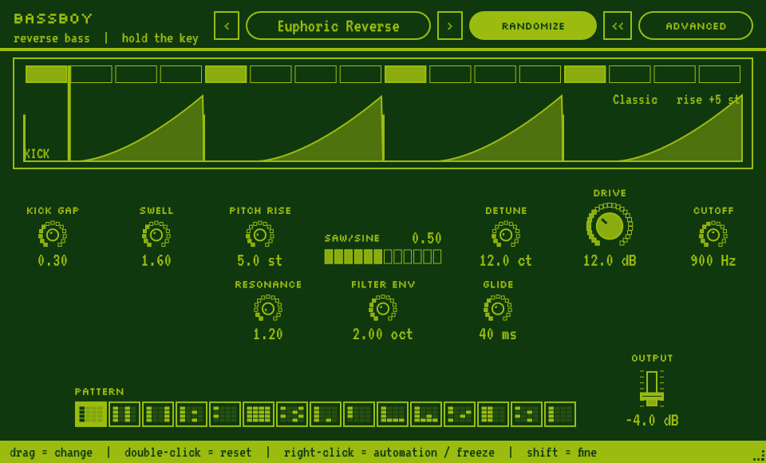 | 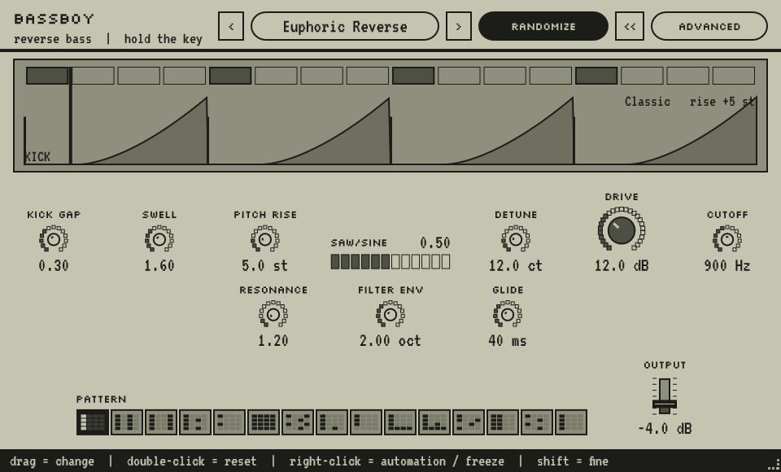 | 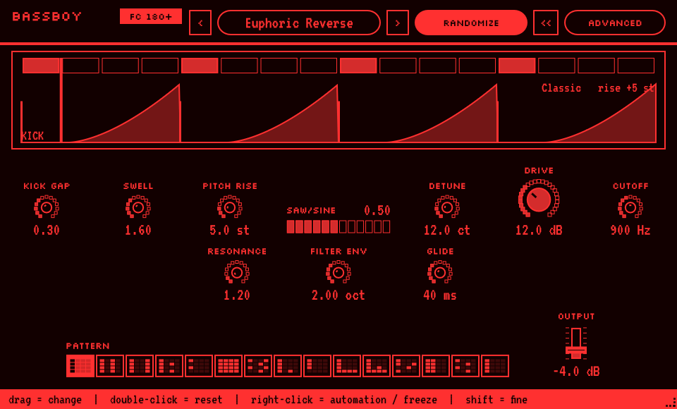 |
| TUNEBOY | 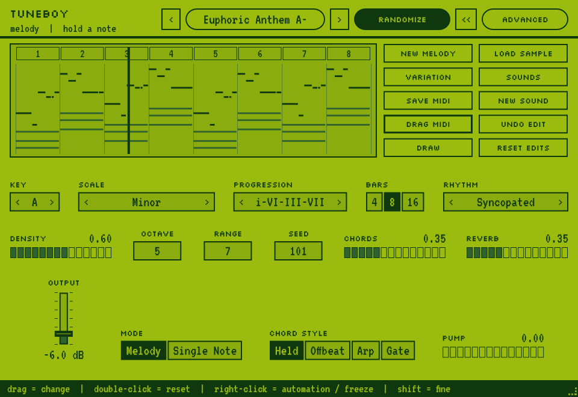 | 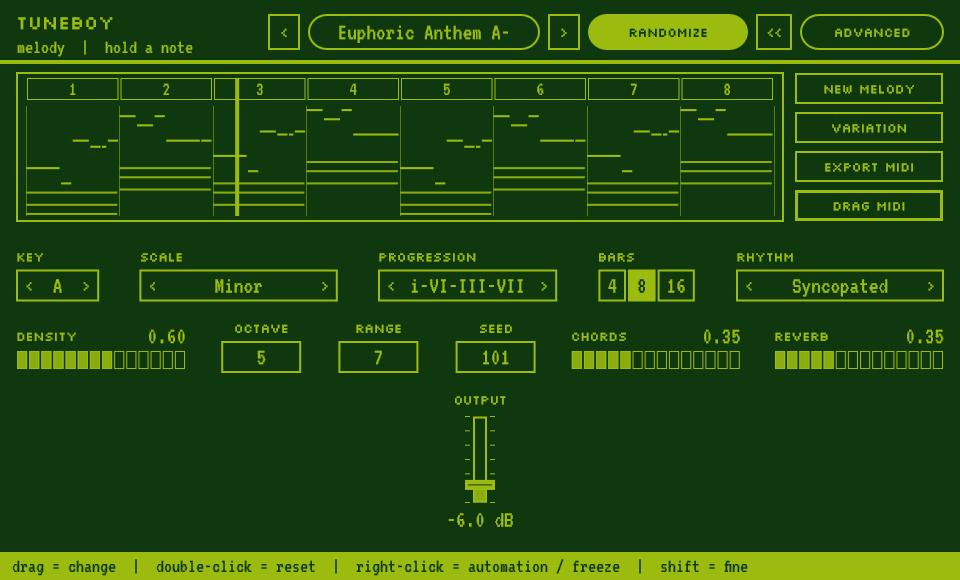 | 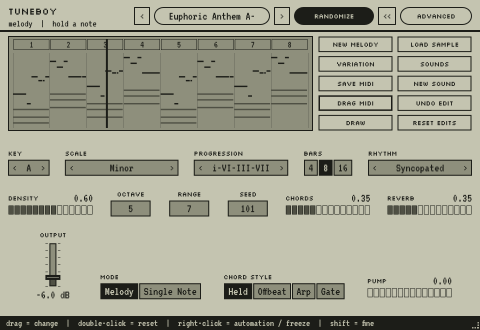 | 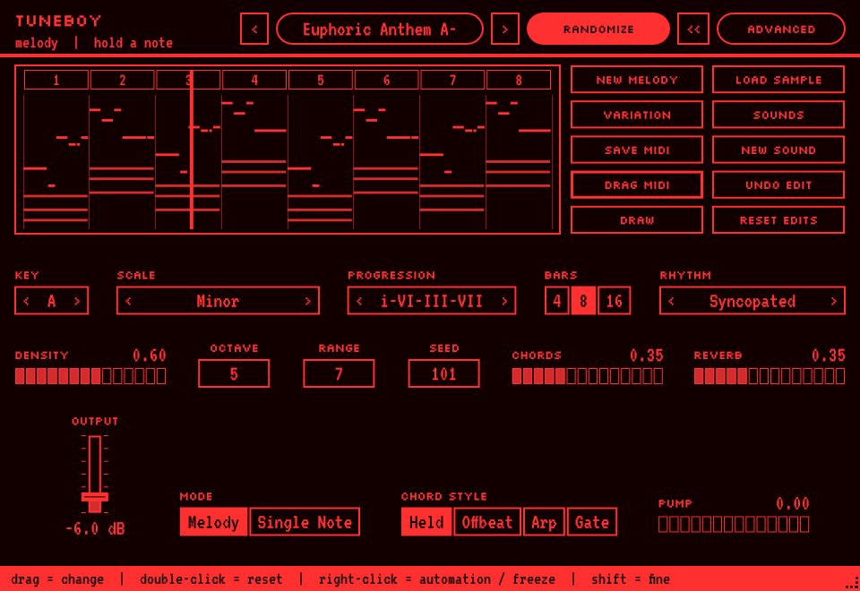 |

ADVANCED page (Screen theme): [KICKBOY](docs/screenshots/kickboy-advanced.png), [BASSBOY](docs/screenshots/bassboy-advanced.png), [TUNEBOY](docs/screenshots/tuneboy-advanced.png).

## Source
`src/<NAME>_kod_zrodlowy/` has one CMake project per plugin; shared code is in `src/BOY_shared/` (`BoyCommon.h` colours,
themes and params, `BoyUI.h` the painted editor). JUCE 8.0.4. Each plugin's render test must print `RESULT: PASS`.
See `src/BOY_shared/CLAUDE.md` and `PRZECZYTAJ.md` (Polish).

Fonts: Silkscreen and VT323 (SIL OFL 1.1, licences in `src/BOY_shared/fonts`), subset to Latin.
